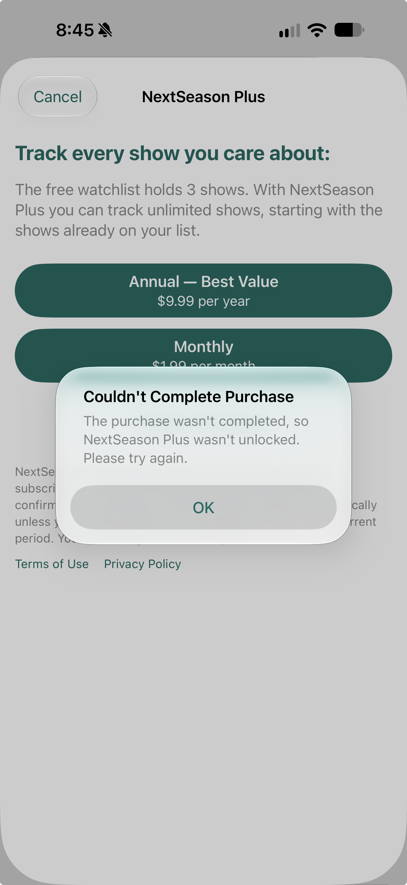

# StoreKit 7C — Monthly purchase fails first attempt when reactivating a saved show

**Reported October 28, 2026. Status: open owner-observed manual failure; not independently reproduced or fixed.** Related manual coverage: focused 7B/7C, SK-17 and Monthly purchase SK-04.

## Trigger and observed behavior

While attempting to purchase Monthly Plus to add/reactivate a show already saved on the Watchlist, the first attempt displays an error rather than completing the purchase. Owner reports previously seeing this intermittently in other purchase situations, but it appears to happen on every attempt at this particular scenario. The second try always succeeds in the owner's observations. These are reported frequencies, not a measured reproduction rate.

The supplied screenshot shows the NextSeason Plus paywall with this alert:

> Couldn't Complete Purchase
>
> The purchase wasn't completed, so NextSeason Plus wasn't unlocked. Please try again.

Expected: an eligible Monthly purchase completes on the first attempt, without a retry-only error. Once Plus is confirmed, the already-saved show becomes active exactly once, preserving its identity and the other saved shows. Successful retry does not turn the initial failure into a passing result.

## Evidence and limits

Screenshot supplied by owner, named October 28 at 8:45:56 PM; the screen clock shows 8:45. It establishes the alert wording and the presented paywall, not the underlying StoreKit outcome. The screenshot does not identify the show, app build, scheme, install source, device/OS or transaction ID. The exact Search versus Show Detail entry point, active-show count, pause status, subscription/complimentary state, Apple confirmation-sheet behavior, and transaction timeline were not supplied with this report. Do not assign the earlier simulator/build-50 environment to this observation merely because it occurred in the same discussion.

The wording matches an application-level purchase-without-effective-access error, but this report alone does not establish whether Apple reported success, which transaction was returned, or the reason access was not unlocked on the first attempt. Keep it distinct from the pending-after-relaunch 4C and declined-purchase 4D observations; no common cause is established.

## Tracking

Attributed to focused **7C** at the owner's request. Focused 7B already exercises an already-saved paused show's purchase/reactivation; 7C reuses that setup and records first-attempt versus retry behavior rather than requiring an unrelated new setup. Keep the original error evidence even if retry succeeds. No app code, test account, scheme or transaction state changed to record this issue; no app tests ran.
