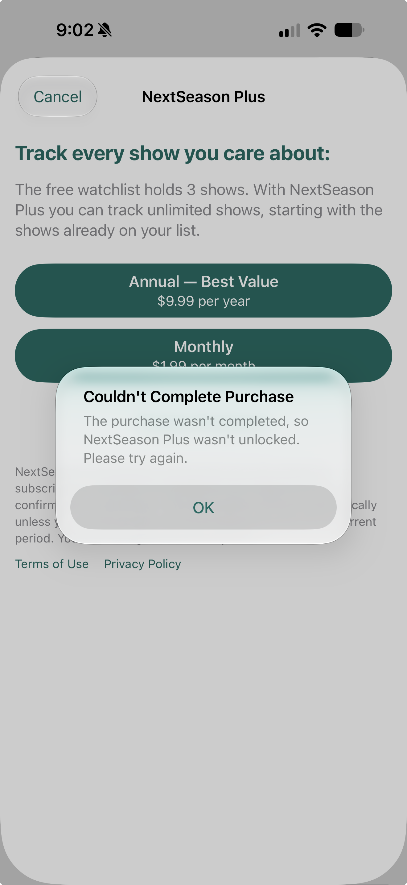

# StoreKit 8C — Purchase fails after restoring network connectivity

**Reported October 28, 2026. Status: open owner-observed recovery failure; not independently reproduced or fixed.** Related coverage: focused 8C, SK-18 and purchase/network recovery.

## Reported sequence

1. During 8C, attempt Restore Purchases without network connectivity; the app displays the generic restore error recorded separately below.
2. Restore network connectivity.
3. Dismiss the restore error.
4. Retry the purchase. NextSeason displays **Couldn't Complete Purchase** with **The purchase wasn't completed, so NextSeason Plus wasn't unlocked. Please try again.**

Owner reports this sequence seems repeatable. No measured attempt count was supplied. The reported retry is a purchase attempt; do not silently rewrite it as a second Restore Purchases attempt. The exact control/plan tapped and whether Apple's payment sheet appeared remain unconfirmed.

## Expected behavior

After connectivity returns and the restore error is dismissed, a valid purchase should be usable and complete through the normal purchase flow. A previous failed Restore must not leave purchase state preventing recovery. Confirmed purchase success must unlock Plus and complete the original blocked add/reactivation once, without duplicate rows. This expectation does not assume the failed attempt actually completed or charged anything.

## Evidence and limits

The supplied screenshot is named October 28 at 9:02:39 PM and its screen clock shows 9:02. It establishes the purchase-not-unlocked alert on the Plus paywall. Exact build, install source/scheme, device/OS, starting access, target show, transaction ID, reconnection delay, and later recovery outcome were not supplied. Do not infer these from other reports. In particular, unlike 7C, no successful second attempt was reported for this sequence.

The message matches the one seen in [7C's first-attempt purchase failure](StoreKitMonthlyFirstAttempt-2026-10-28.md), but identical wording does not establish a common cause. No transaction outcome/error code was captured for this report. Keep this functional recovery failure separate from the [8C restore-message improvement](StoreKitRestoreErrorMessaging-2026-10-28.md), which only concerns the prior alert's title/body.

## Follow-up evidence

On a focused reproduction, record which control was tapped (Monthly/Annual versus Restore), actual connection availability, Apple's sheet/result, and diagnostics around both the failed Restore and the later purchase. Preserve the initial failure even if a later attempt succeeds. Check that purchase/restore busy state and errors clear correctly on each completed attempt; establish the cause before changing entitlement policy.

No app code, account, scheme or transaction state changed to record this report. No app tests ran; no fix, shared cause, charge or release waiver is asserted.
