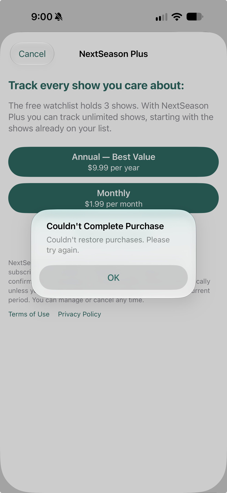

# StoreKit 8C — Restore error wording

**Reported October 28, 2026. Status: open presentation improvement; not implemented.** Related coverage: focused 8C and SK-18.

During offline Restore testing, the owner saw an alert titled **Couldn't Complete Purchase** with the body **Couldn't restore purchases. Please try again.**

## Requested improvement

- Use **Couldn't Restore Purchases** as the title for a failed Restore operation. Preserve purchase-specific titles for actual purchase failures.
- When the underlying error identifies a network failure, provide actionable wording: **Couldn't restore purchases. Check your internet connection and try again.**
- Keep **Couldn't restore purchases. Please try again.** as a fallback for failures whose cause is not identified. Do not label every restore failure as a network outage.
- Preserve cancellation handling, current access, saved shows and retry behavior. This is a wording/error-classification task, not a change to entitlement policy.

## Evidence and verification

The screenshot confirms the generic body and purchase-specific heading. Code inspection found the restore method in `NextSeason/Services/Purchases/PurchaseService.swift` maps non-cancellation thrown errors to the same generic message; `NextSeason/Features/Store/PlusStoreView.swift` uses the purchase-specific alert title. The underlying error for this observation was not captured, so the screenshot alone does not establish a specific Apple/network error code. No exact build, device/OS or installation source is assigned to this report.

When implemented, check an identifiable network error, an unrelated/unknown restore error and cancellation; confirm the title/body fit the action and retry remains usable after connectivity returns. Normal no-active-subscription feedback remains a separate result, not a failed network restore.

No app code or tests changed and no app tests ran to record this task. The earlier pending/decline and first-attempt purchase failures remain separate issues.
